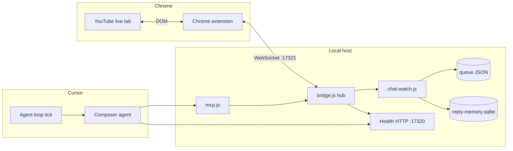

# How YouTube live chat automation works

This stack lets a **Cursor agent** read YouTube live chat in a **background Chrome tab**, decide whether to reply, and post **one short human line** without turning on Chrome remote debugging.

The default mode does **not** use hardcoded reply pools. The bridge **scans** chat and **queues work**; **you** (the agent in Cursor) read context, compose, and send.

---

## Big picture



| Piece | Role |
|-------|------|
| **Extension** | Stays connected to the bridge, runs commands on tabs (list tabs, extract live chat, fill/send reply). |
| **bridge.js** | WebSocket hub on `127.0.0.1:17321`; optional health HTTP on `17320`; runs embedded **chat-watch** when `CHAT_WATCH=1`. |
| **chat-watch.js** | Every N seconds: find a YouTube watch/live tab, pull chat, detect new lines, enqueue a **job** (cursor mode) or call an LLM API (api mode). |
| **chat-queue.js** | One job file at a time (`/tmp/ytchat-agent-queue.json`): transcript, candidates, tab id, status `pending` → `processing` → `done`. |
| **Cursor agent** | On each loop tick: claim job, read memory + transcript, reply or skip, **complete** job. |
| **reply-memory.js** | SQLite log of **what you said** so drafts are not repeated and obvious contradictions are blocked. |

---

## End-to-end flow (cursor mode)

1. **Extension** connects to `ws://127.0.0.1:17321/extension` (popup shows **Connected**).
2. **bridge** starts with `CHAT_WATCH=1` (often via `systemd --user` `chrome-agent-bridge.service`).
3. **chat-watch** calls `extractLiveChat` on the YouTube tab (tab does **not** need focus).
4. New messages are compared to **state** (`/tmp/ytchat-agent-state.json`): `seen`, `answered`, cooldown since `lastReplyAt`.
5. If there are new candidates and rate limits allow, a **job** is written to the queue and those lines are marked **seen** so the same batch is not re-queued every scan.
6. A **background shell loop** in Cursor prints `AGENT_LOOP_TICK_ytchat` on a timer (~12s). That tick should follow `server/AGENT-LOOP-PROMPT.md`.
7. The agent:
   - `GET /chat/agent-job` or MCP `chrome_youtube_chat_job` with `claim: true`
   - Reads `memory.whatYouSaid` and the transcript
   - **Skips** banter, allies, already-answered threads, or anything that would repeat banned templates
   - **Replies** with MCP `chrome_send_youtube_reply` (or bridge HTTP + extension) when warranted
   - `chrome_youtube_chat_complete` or `POST /chat/agent-complete` with `messageKeys`, `reply` or `skipped`
8. **applyAgentCompletion** marks messages **answered**, updates state, and **recordReply** logs to SQLite.

`agent-tick-once.js` is only for optional **API mode** when `CHAT_AI_API_KEY` is set; in pure cursor mode it exits without posting.

---

## Reply modes

| Mode | Env | Who composes |
|------|-----|----------------|
| **cursor** (default) | `CHAT_REPLY_MODE=cursor` | Cursor agent (this chat + MCP) |
| **api** | `CHAT_REPLY_MODE=api` + `CHAT_AI_API_KEY` | `chat-ai.js` (OpenAI-compatible API) |

Voice and behavior rules live in `server/chat-voice.md`. The API path still uses **reply memory** and similarity checks.

---

## “What you said” memory

Goal: **not sound like a bot** (no repeating the same lecture line, no contradicting yourself).

- **Database:** `~/.local/state/chrome-agent/reply-memory.sqlite`
- **Context before draft:** MCP `chrome_reply_memory_context` or job payload `memory.whatYouSaid`
- **Before send:** MCP `chrome_reply_memory_check` (duplicates, near-repeats, banned phrases, simple contradiction rules)
- **After send:** automatic via `chrome_send_youtube_reply` or `agent-complete` with `reply`

Details: [CHAT-MEMORY.md](./CHAT-MEMORY.md).

---

## HTTP endpoints (health port, default 17320)

| Method | Path | Purpose |
|--------|------|---------|
| GET | `/chat/agent-job` | Active job + memory brief (only `pending` / `processing`) |
| POST | `/chat/agent-claim` | Mark job `processing` |
| POST | `/chat/agent-complete` | Skip or finish; updates watcher state |
| GET | `/chat/memory` | What you said + stance brief |

Bridge WebSocket remains on **17321** (extension + MCP client).

---

## MCP tools (Cursor)

Configured in Cursor MCP as `node …/server/mcp.js`. Important tools:

| Tool | Use |
|------|-----|
| `chrome_bridge_status` | Extension connected? |
| `chrome_list_tabs` | Find YouTube `tabId` |
| `chrome_youtube_chat_job` | Claim and read queued work |
| `chrome_reply_memory_context` | WHAT YOU SAID + stances |
| `chrome_reply_memory_check` | Validate draft |
| `chrome_send_youtube_reply` | Type + submit in chat (records memory) |
| `chrome_youtube_chat_complete` | Tell watcher the job is done |

Reload MCP in Cursor after tool changes.

---

## Files and state

| Path | Contents |
|------|----------|
| `/tmp/ytchat-agent-queue.json` | Current agent job (cleared after complete) |
| `/tmp/ytchat-agent-state.json` | Seen/answered keys, recent reply texts, last reply time |
| `/tmp/ytchat-agent-status.json` | Last watcher heartbeat / errors |
| `~/.local/state/chrome-agent/reply-memory.sqlite` | Long-lived reply + banned-phrase memory |

---

## Environment variables (common)

| Variable | Default | Meaning |
|----------|---------|---------|
| `CHAT_WATCH` | off unless `1` | Run embedded chat watcher in bridge |
| `CHAT_REPLY_MODE` | `cursor` | `cursor` or `api` |
| `CHAT_WATCH_MS` | `10000` | Scan interval |
| `CHAT_REPLY_GAP_MS` | `25000` | Min time between sends |
| `CHROME_BRIDGE_PORT` | `17321` | WebSocket |
| `CHROME_BRIDGE_HEALTH_PORT` | `17320` | HTTP agent API |
| `CHAT_AI_API_KEY` | — | Required for `api` mode / `agent-tick-once.js` compose |
| `CHAT_MEMORY_DB` | — | Override SQLite path |

Optional: `~/.config/chrome-agent-bridge.env` loaded by systemd `EnvironmentFile`.

---

## Typical systemd setup

User unit `~/.config/systemd/user/chrome-agent-bridge.service` runs `node bridge.js` (or `mcp.js` hub) with `CHAT_WATCH=1`, `CHAT_REPLY_MODE=cursor`, etc.

```bash
systemctl --user enable --now chrome-agent-bridge.service
systemctl --user restart chrome-agent-bridge.service   # after code changes
```

---

## Extension deployment

After changing `extension/`, reload unpacked extension in Chrome (often copied to `~/Desktop/Chrome-Agent-Bridge`). Reload the YouTube tab once so content scripts inject.

**Policy:** do not focus or switch tabs for automation; background YouTube is enough.

---

## Agent loop in Cursor

A recurring shell task emits `AGENT_LOOP_TICK_ytchat`. Each tick should:

1. Fetch job; if empty, **stop** (no user noise).
2. Read transcript + **what you said**.
3. Compose fresh or skip.
4. Complete the job.

Step-by-step: `server/AGENT-LOOP-PROMPT.md`.

---

## Repo map

```
tools/chrome-agent-bridge/
  HOW-IT-WORKS.md          ← this file
  CHAT-MEMORY.md           ← SQLite / dedupe
  README.md                ← install + MCP config
  extension/               ← Chrome MV3
  server/
    bridge.js              ← hub + health HTTP + optional watch
    chat-watch.js          ← scanner + queue
    chat-queue.js          ← job file
    chat-agent-http.js     ← /chat/* routes
    reply-memory.js        ← what you said
    chat-ai.js             ← optional API composer
    chat-voice.md          ← tone / skip rules
    mcp.js                 ← Cursor MCP entry
    agent-tick-once.js     ← optional API-only tick helper
    AGENT-LOOP-PROMPT.md     ← per-tick checklist
```

---

## Failure modes

| Symptom | Check |
|---------|--------|
| No jobs | Extension disconnected; no YouTube tab; chat empty; everything already `answered` |
| Jobs repeat | Restart bridge after queue fixes; ensure `agent-complete` runs with `messageKeys` |
| `posted: false` | Tab in background, YouTube UI changed; extension version / send selectors |
| Sounds like AI | Read memory; run `chrome_reply_memory_check`; ban phrases via CLI or MCP |

---

## Related docs

- [README.md](./README.md) — install extension and MCP
- [CHAT-MEMORY.md](./CHAT-MEMORY.md) — reply database
- [server/AGENT-LOOP-PROMPT.md](./server/AGENT-LOOP-PROMPT.md) — what each tick must do
